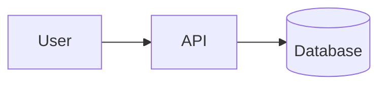

# <system> — high-level design

## 1. Context and scope
<What this system is, which PRD requirements it serves, and its boundary. Link FR/NFR ids.>

## 2. Deployment target
<Where and how this runs in production: platform, environments, regions, runtime. The AI-SDLC
builds towards a clear deployment target — name it here, before implementation starts.>

## 3. Architecture overview

<One paragraph explaining the diagram: main flows and why the boundaries are where they are.>

## 4. Components
| Component | Responsibility | Owns data | Code location |
|---|---|---|---|
| <name> | <single responsibility> | <entities> | `<path>` |

## 5. Interfaces and contracts
| Interface | Provider → consumer | Style | Contract |
|---|---|---|---|
| <name> | <A → B> | REST / event / CLI / library | `<path to schema>` or section |

## 6. Data
<Model, storage, ownership, retention, migration approach. Link an LLD for anything non-trivial.>

## 7. Quality attributes
| NFR | Tactic | Verified by |
|---|---|---|
| NFR-001 | <caching, retries, scaling, …> | <test, load test, monitor> |

## 8. Cross-cutting concerns
- **Security:** <authn, authz, secrets, data protection>
- **Observability:** <logs, metrics, traces, alerts — what monitoring needs from the code>
- **Configuration:** <how config and feature flags are supplied per environment>
- **Error handling:** <failure model, retries, idempotency>

## 9. Traceability
| Requirement | Satisfied by (section / component) |
|---|---|
| FR-001 | §4 <component> |

## 10. Risks and technical debt
- <risk> — <mitigation> — <early signal>

## 11. Open questions
- **Q-01** — <question> — **Assume:** <default>

## 12. Changelog
| Version | Date | Change | Trigger |
|---|---|---|---|
| 0.1.0 | <YYYY-MM-DD> | Initial draft | PRD-<KEY> v<x> |
