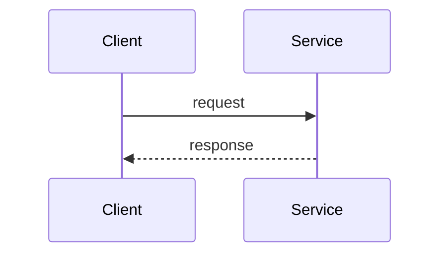

# <topic> — low-level design

## 1. Purpose and scope
<The one problem this LLD details, and the HLD section it refines.>

## 2. Design
<Modules, types, functions, schemas — concrete enough that a builder can implement without
inventing structure. Name files and directories.>

## 3. Interfaces
<Signatures, endpoints, message schemas, error codes. Link machine-readable contracts.>

## 4. Data and migrations
<Tables/collections, indexes, migration steps, backward compatibility, rollback.>

## 5. Error handling and edge cases
| Case | Behaviour |
|---|---|
| <input/state> | <expected outcome> |

## 6. Test strategy
<What is unit-, integration-, and contract-tested; fixtures; how coverage is reached.>

## 7. Rollout
<Ordering, feature flags, compatibility windows.>

## 8. Open questions
- **Q-01** — <question> — **Assume:** <default>

## 9. Changelog
| Version | Date | Change | Trigger |
|---|---|---|---|
| 0.1.0 | <YYYY-MM-DD> | Initial draft | <run slug / request> |
